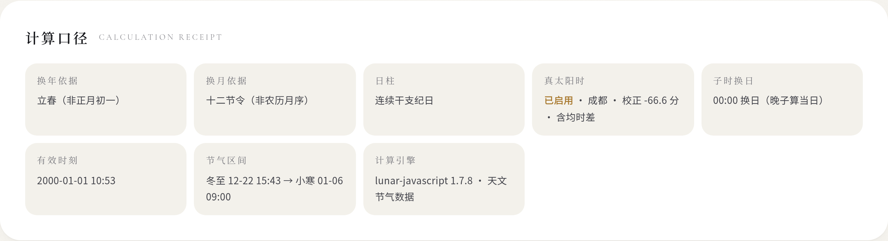

<div align="center">


# 命理 ATELIER · fate

**八字 · 紫微 · 易经，一个外壳里的确定性排盘工具。**

*A unified Chinese metaphysics workbench — BaZi (Four Pillars), Zi Wei Dou Shu and I Ching — as a web app, with an optional Windows desktop build.*

[](https://qiuizi.github.io/fate/)
[](https://qiuizi.github.io/fate/app/)
[](https://github.com/Qiuizi/fate/actions/workflows/ci.yml)
[](./LICENSE)
[](https://react.dev)
[](https://www.typescriptlang.org/)
[](https://vite.dev)
[](https://www.electronjs.org/)

[介绍页](https://qiuizi.github.io/fate/) · [在线体验](https://qiuizi.github.io/fate/app/) · [更新日志](./CHANGELOG.md)


</div>

---

本仓库由原来的两个项目合并而来：**八字排盘 ATELIER**（`Qiuizi/bazi`，含已嵌入的紫微斗数子页）与 **易经起卦工作台**（`Qiuizi/yijing-workbench-public`）。易经部分已在浏览器侧用 TypeScript 重写，六十四卦原文数据随仓库一起放在 `data/yijing/`，不再依赖任何外部目录。

> 准确为先，审美其后。所有断语、评分都只是参考，不做确定结论。

**亮点**

- **口径回执**：每张命盘逐项列出换年、换月、日柱、真太阳时、有效时刻与节气区间的实际取法，结果可核对、可复现。
- **独立交叉核对**：500 个合成时刻（含交节前后、23:00–01:00 子时边界、真太阳时）与不依赖 lunar-javascript 的参考实现（PyEphem 天文计算 + 儒略日数推干支，sxtwl 复核）逐项比对：四柱 4000/4000 一致，交节时刻差 ≤ 57 秒，真太阳时差 ≤ 44 秒，起运方向全部一致。详见[交叉核对](#交叉核对)。

  

  <sub>合成示例（非真人）：公历 2000-01-01 12:00 男，成都，真太阳时开启（校正 −66.6 分，有效时刻 10:53）→ 时柱丁巳；关闭真太阳时则为戊午。另见[手机版回执](docs/assets/12-receipt-m.png)与[同一示例的四柱](docs/assets/13-pillars-tst-d.png)。</sub>

- **复制给 AI 与 Agent Skill**：一键复制排好的命盘与解读提示词，粘贴到任意 AI 即可；程序排盘，AI 只解读（详见[复制给 AI](#ai-export)）。同一套解读规则打包成 [Agent Skill](skills/fate-bazi-reader/SKILL.md)，可用下面的命令装进 Claude Code 等支持 Agent Skill 的工具：

  ```bash
  npx skills add Qiuizi/fate
  ```

- **字体随仓库自托管**：不再请求 Google Fonts，国内网络下字形与线上一致。

## 目录

- [三个模块](#三个模块)
- [界面预览](#界面预览)
- [计算口径](#计算口径)
- [交叉核对](#交叉核对)
- [快速开始](#快速开始)
- [脚本一览](#脚本一览)
- [目录结构](#目录结构)
- [部署（GitHub Pages）](#部署github-pages)
- [数据来源与许可](#数据来源与许可)
- [声明](#声明)

## 三个模块

顶部页签在 **八字排盘 / 紫微斗数 / 易经六爻** 之间切换，不跳页；也可用 `?mod=bazi|ziwei|yijing` 直达。

### 八字排盘

- **排盘内核**：立春换年、十二节令换月、连续干支纪日、五鼠遁时；**真太阳时**（经度校正 + NOAA 均时差），出生地可搜索全国 2890 个区县（内建经度）；23:00 / 00:00 两种子时换日；农历输入支持闰月与真实大小月；出生时间落在中国历史夏令时期间（1935–1979 年间若干年、1986–1991 年）时给出提示，可一键减 1 小时按标准时间排盘。
- **计算口径回执**：逐项列出本次命盘实际用到的换年、换月、日柱、真太阳时、有效时刻与节气区间，可核对、可复现。
- **四柱表**：干支按五行上色，附藏干、十神、纳音、星运、自坐、空亡。
- **五行环**：弧长按比例编码气数（明字 / 含藏干加权），与四柱、神煞、十神之间**按颜色联动高亮**。
- **神煞与关系**：天乙、文昌、驿马、桃花等神煞；天干五合，地支六合、三合、六冲、相害、相刑，标注涉及柱位。
- **旺衰 · 格局 · 喜用**（参考）：旺衰评分、月令本气取格、调候与近似喜用。
- **时间轴五级下钻**：大运 → 流年 → 流月 → 流日 → 流时，流年 / 流月带联动断语与近似喜忌。
- **古籍断语与竖排命书**：分类长文，点命盘元素直达对应断语；竖排线装命书（封面题签、卷首五行图、目录、鱼尾版心、朱墨套印），可打印或另存 PDF。
- **双人合盘**：契合总分 + 7 维评分（日主关系、生肖合冲、夫妻宫、五行互补、用神互济、纳音、十神互动）、双方四柱与大运同步，可导出 HTML / PDF。
- **历史与导出**：本机自动存档、命名分组、JSON 备份导入；分享深链、分享卡片 PNG；HTML / Markdown（含结构化 JSON）/ PDF 导出。
- <a id="ai-export"></a>**复制给 AI**：导出菜单一键复制「解读提示词 + 命盘」，粘贴到任意 AI 对话即可（精简版约 3 千字，不重复附 JSON）；下载的 .md 为完整版（另附 `fate.bazi.ai.v1` JSON），.json 为纯数据。程序排盘，AI 只解读：数据与页面上的盘逐项一致（含口径回执、出生时刻临近时辰分界或交节时的临界提醒、今年前后 5 年的流年时间表），提示词要求 AI 不得改盘、每条判断注明依据、区分盘面事实与推断并标把握、信号冲突时说明取舍、把合冲只当「存在」、按「旺衰 → 格局 → 调候 → 喜用忌」写用神推导链，并在末尾自检。提示词最后留有「我想问」：写下具体问题（事业、感情、某一年）就只围绕问题回答。可选「隐去生辰」（不含出生日期、时刻、地点，保留四柱与大运；注意四柱本身仍可反推大致生日）；合盘页顶栏可复制双方命盘与评分（默认隐去生辰）。同一套规则也打包成 Agent Skill：[`skills/fate-bazi-reader/SKILL.md`](skills/fate-bazi-reader/SKILL.md)。

### 紫微斗数

- 以静态子页形式嵌入（`public/ziwei/`，由独立的 ziwei 项目构建产出），排盘基于 [iztro](https://github.com/SylarLong/iztro)。
- 十二宫、星曜亮度、四化、大限流年；附天纪知识条目（见下文许可说明）。
- 可选的 AI 解读：用户自填 API Key，支持 DeepSeek、Moonshot（Kimi）、硅基流动、OpenAI 与本地 Ollama。仓库不含任何 Key。

### 易经六爻

- **起卦**：铜钱三枚六次，或手动指定六爻；记录起卦时间，自动求日柱与月建，也可手动指定。
- **本卦 / 之卦 / 动爻**，按《易学启蒙通释》的变爻取辞规则给出所取卦辞、爻辞。
- **纳甲**：八宫、六亲、世应、六神、伏神（依《增删卜易》）、旬空。
- **用神与冲合**：按占问类别对照用神，只标记典籍里的对应关系，不判吉凶、不替你选唯一用神。
- **六十四卦图** 与卦辞、爻辞全文、学习导读；本机保存起卦记录。

## 界面预览

| 八字结果页 | 五行环与颜色联动 |
|---|---|
|  |  |

| 大运五级下钻 | 古籍断语 |
|---|---|
|  |  |

| 双人合盘 | 易经起卦 |
|---|---|
|  |  |

## 计算口径

| 维度 | 采用口径 |
|---|---|
| 年柱 | 立春换年（不是正月初一） |
| 月柱 | 十二节令换月（不是农历月序） |
| 日柱 | 连续干支纪日 |
| 时柱 | 依日干五鼠遁 |
| 真太阳时 | 经度校正 `4×(经度−120°)` + NOAA 均时差 |
| 子时换日 | 23:00 换日 / 00:00 换日，可切换 |
| 节气 | 按交节精确时刻判断（交节当天、交节前出生仍属上一个节） |
| 夏令时 | 只提示，用户确认后才减 1 小时 |
| 农历输入 | 支持闰月，按真实大小月天数 |
| 六爻取辞 | 《易学启蒙通释》变爻规则 |
| 纳甲 | 《增删卜易》八宫、六亲、世应、六神、伏神 |

## 交叉核对

`npm run test:crosscheck` 用随仓库提交的参考数据（`scripts/crosscheck/cases.json`）逐项核对八字内核，结果写在 `scripts/crosscheck/summary.json`。参考数据由 `npm run crosscheck:gen`（需 Python 与 `pip install ephem sxtwl`）按固定种子重新生成，全部是合成时刻，不含真实生辰。

| 项目 | 样本 | 结果 |
|---|---|---|
| 四柱（两种子时口径 × 四柱） | 500 个时刻，4000 项 | 全部一致 |
| 前后节的交节时刻 | 1000 | 最大差 57 秒（2024 年前 ≤ 18 秒，之后的差来自两边对未来 ΔT 的外推不同） |
| 真太阳时 | 80 | 最大差 44 秒（NOAA 均时差近似 vs 天文视太阳时） |
| 起运方向 / 起运时间 | 500 | 方向全部一致；时间最大差 14.9 天（lunar-javascript 按时辰取整的口径） |
| 首步大运、节气区间标签 | 500 | 全部一致 |

这套核对发现并修复了一个真实问题：交节当天、交节时刻之前出生时，月柱是对的，但口径回执里的「节气区间」把尚未交的节当成了前一个节（旧代码 500 例中 58 例不一致）。

## 快速开始

需要 Node.js 20.19+ 或 22.12+（Vite 8 的要求）。

```bash
git clone https://github.com/Qiuizi/fate.git
cd fate
npm install
npm run dev          # http://127.0.0.1:5173
```

桌面版（Windows，Electron 壳内嵌同一份 `dist`；目前没有发布 Releases 安装包，需要本地自行打包）：

```bash
npm run desktop        # 构建后在桌面窗口启动
npm run desktop:build  # 生成 release/ 下的便携版和安装版 exe
```

分享深链示例。两条八字链接使用同一合成生辰（公历 2000-01-01 12:00，仅供演示）。

```
/?y=2000&m=1&d=1&h=12&mi=0&g=male
/?cal=lunar&y=1999&m=11&d=25&h=12&mi=0&g=male
/?mod=yijing
```

## 脚本一览

| 命令 | 作用 |
|---|---|
| `npm run dev` | 开发服务器 |
| `npm run typecheck` | TypeScript 类型检查 |
| `npm run build` | 类型检查 + 生产构建到 `dist/` |
| `npm run build:yijing` | 易经引擎自检（保留原命令名，易经由主应用构建） |
| `npm run test:calc` | 排盘准确性回归（48 项断言） |
| `npm run test:ai` | 「复制给 AI」导出自检：数据与排盘逐项一致、精简版事实齐全、临界提醒、隐私模式不含生辰、SKILL.md 同步 |
| `npm run gen:ai-skill` | 由导出规则重新生成 `skills/fate-bazi-reader/SKILL.md` |
| `npm run test:crosscheck` | 与独立参考实现交叉核对（500 个时刻）；`crosscheck:gen` 重新生成参考数据 |
| `npm run test:e2e` | 八字端到端冒烟（45 项，需先启动 dev；可用 `BASE=` 指定地址） |
| `npm run test:unified` | 三模块联合冒烟（16 项，同上） |
| `npm run export:vbook` | 竖排命书整本长图 |
| `npm run fonts:build` | 重新生成自托管字体子集（需 Python 与 fonttools、brotli） |
| `npm run desktop` / `desktop:build` | 桌面版运行 / 打包 |

端到端测试用本机 Chrome（`puppeteer-core`），路径可用 `CHROME_PATH` 覆盖。CI（`.github/workflows/ci.yml`）在每次推送时跑类型检查、`test:calc`、`test:ai`、`test:crosscheck`、易经引擎自检与构建。

## 目录结构

```
src/
  Shell.tsx            # 统一外壳：首页 + 三个模块页签
  Portal.tsx           # 首页
  App.tsx              # 八字：视图切换、深链、历史
  lib/                 # 八字内核：bazi / extras / shensha / relations / structure / classics / compat / 导出
  components/          # 八字界面组件
  yijing/              # 易经六爻：engine.ts（起卦/取辞/纳甲）、analysis.ts（用神与冲合）、App.tsx
  styles.css           # 基础样式
  atelier.css          # 「墨 · 纸 · 金」界面层（最后加载）
data/yijing/
  hexagrams.json       # 六十四卦原文（维基文库《周易》，CC BY-SA 4.0）
  learning_guides.json # 各卦学习导读
  SOURCE.md            # 数据来源、修订号与核对说明
public/
  ziwei/               # 紫微斗数子页（构建产物）与知识库
  yijing/index.html    # 兼容易经独立子页旧书签的跳转页
  fonts/               # 自托管字体子集（woff2 + CSS + OFL 许可）
electron/              # 桌面版主进程
scripts/               # 测试、构建辅助脚本
docs/                  # GitHub Pages：介绍页 index.html + 在线应用 app/
```

## 部署（GitHub Pages）

Pages 从 `main` 分支的 `/docs` 发布：

- 介绍页：<https://qiuizi.github.io/fate/>
- 在线应用：<https://qiuizi.github.io/fate/app/>
- 易经入口为 `/fate/app/?mod=yijing`，旧书签 `/fate/app/yijing/` 会自动跳转。

`docs/app/` 是 `npm run build` 的产物（`base: './'`，可放在任意子路径）。更新应用后：

```bash
npm run build
# 用 dist/ 全量替换 docs/app/ 后提交推送
```

## 数据来源与许可

- **应用源码**：[MIT](./LICENSE) © 2026 Qiuizi。
- **六十四卦原文** `data/yijing/hexagrams.json`：取自维基文库《周易》各卦页面，按页面所示 **CC BY-SA 4.0** 提供，修订号与来源链接见 [`data/yijing/SOURCE.md`](./data/yijing/SOURCE.md) 与各条记录。MIT 不覆盖这部分。
- **天纪知识条目** `public/ziwei/knowledge/tianji/`：**CC BY-NC-SA 4.0**，见该目录的 [LICENSE.md](./public/ziwei/knowledge/tianji/LICENSE.md)。MIT 不覆盖这部分，不得商用。
- **字体** `public/fonts/`：Noto Serif SC、Noto Sans SC、Cormorant Garamond，均为 **SIL OFL 1.1**，许可全文随目录提供。字形与 Google Fonts 版本一致，只保留 GB2312 的 6763 个汉字和仓库内实际用到的汉字（共 7115 个）；子集外的生僻字会按样式里的字体链退回系统字体（宋体 / 苹方 / 微软雅黑等）。
- 第三方依赖（React、lunar-javascript、iztro 等）各自适用其许可证。

## 声明

本项目是传统命理文化的学习与研究工具。古籍断语、神煞、旺衰格局评分、合盘与六爻对照都只是参考，不是确定结论，请勿用于重大决策。
